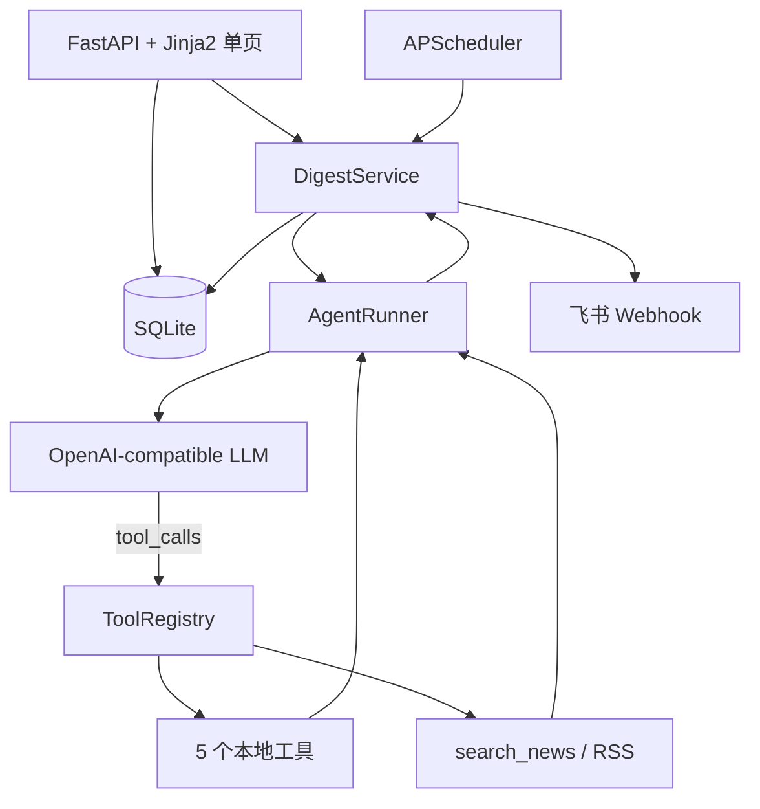

# 架构与关键决策

## 主链路

## 为什么手写 Function Calling Loop

这道题的核心验收点是“工具顺序由 LLM 决定”。项目直接保留循环代码和每轮消息回填，便于面试官确认：

1. 每轮都把同一组工具 Schema 交给模型并使用 `tool_choice=auto`。
2. 模型返回 `tool_calls` 时，应用只负责校验和执行。
3. 工具结果使用对应 `tool_call_id` 回填后再次请求模型。
4. 模型不再返回工具调用时，循环结束。

没有在业务服务中写死 `search_news → summarize → push`。调度、保存和推送是确定性基础设施，不属于 Agent 的信息搜集决策。

## 状态与轨迹

一次运行包含两类轨迹事件：

- `model`：轮次、模型文本和模型选择的工具调用。
- `tool`：工具名、参数、结构化结果、耗时和 `tool_call_id`。

轨迹作为 JSON 随简报保存。模型密钥、Webhook 和内部隐藏推理不会进入轨迹。

## 失败策略

- 模型/API 异常：简报记录变为 `failed`，保存错误消息。
- RSS 异常：工具返回结构化失败，模型可以换关键词或停止。
- 达到 6 轮：中止并保存已有轨迹。
- 重复调用：不再次执行，把 `duplicate tool call` 回填给模型。
- 无搜索或无来源：拒绝把答案标记成功。
- 来源不在搜索结果中：拒绝伪造链接。
- 飞书失败：简报仍为完成状态，`push_status=failed`。

## 安全边界

- 所有文件路径解析后必须位于 `data/workspace`。
- 命令工具只支持明确白名单，不使用任意 `shell=True`。
- Pydantic 在工具执行前校验参数结构和范围。
- 新闻条数、文件输出、搜索命中数和 Agent 轮数均有限制。
